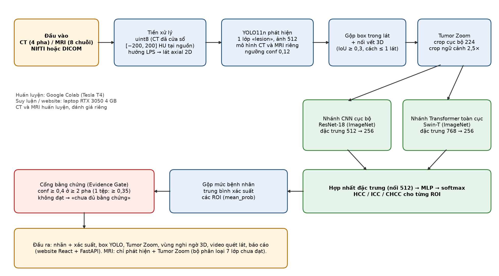
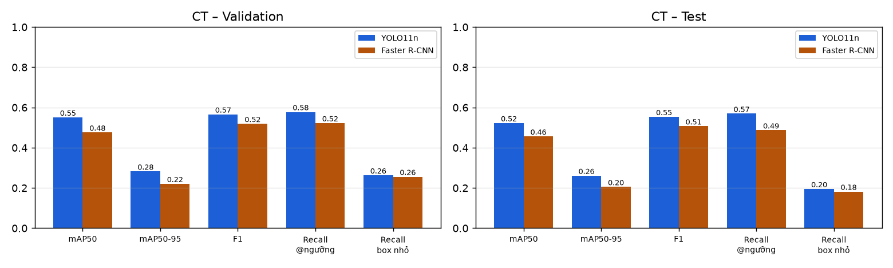
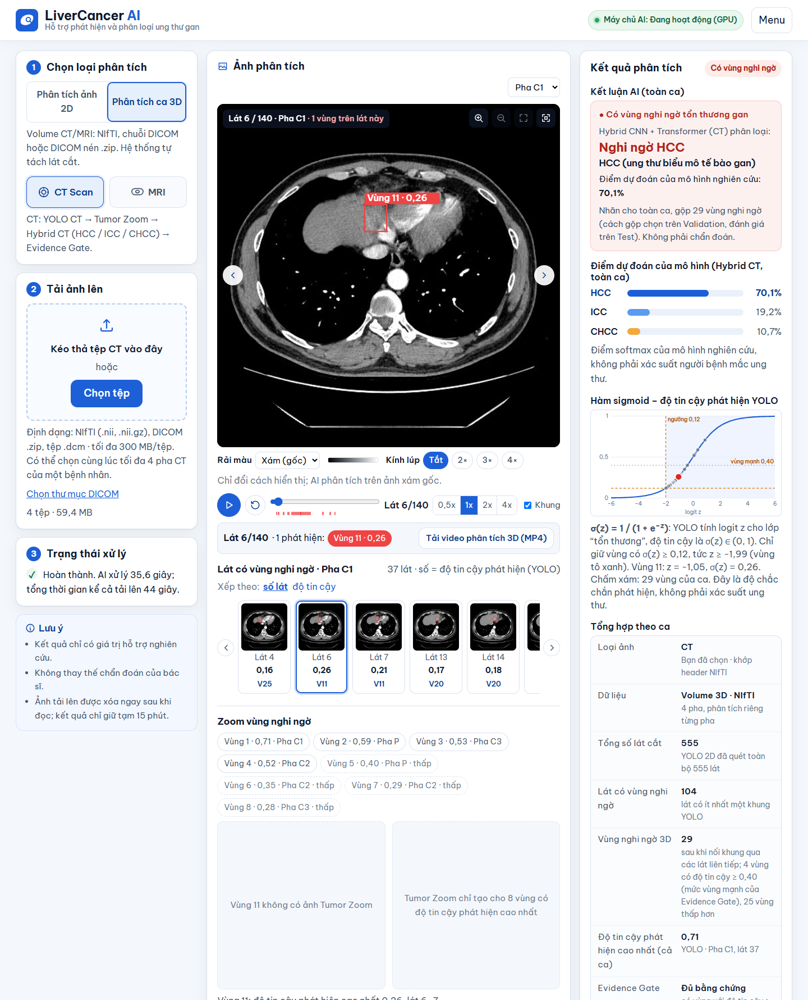

# LiverCancer AI: Phát hiện và phân loại ung thư gan từ ảnh CT/MRI

**Đồ án tốt nghiệp:** *Ứng dụng mô hình học sâu trong phát hiện và phân loại ung thư gan từ ảnh CT/MRI.*

Hệ thống nhận ảnh CT hoặc MRI ổ bụng (NIfTI, DICOM hoặc ảnh 2D) và:
- tự **phát hiện vùng tổn thương gan** bằng YOLO11n;
- **phóng to vùng tổn thương** (Tumor Zoom);
- với CT, **phân loại thể ung thư gan nguyên phát** (HCC / ICC / cHCC-CCA) bằng mô hình lai CNN + Transformer, kèm **cổng bằng chứng**: hệ thống trả lời "chưa đủ bằng chứng" thay vì đoán khi phát hiện yếu.

Kết quả hiển thị trên một website tiếng Việt.

> ⚠️ **Sản phẩm nghiên cứu.** Hệ thống chưa được kiểm định lâm sàng và không phải thiết bị y tế. Kết quả chỉ để tham khảo, không thay thế chẩn đoán của bác sĩ. Hệ thống **không bao giờ** kết luận một người là "khỏe mạnh".



### Chạy lại huấn luyện và đánh giá trên Google Colab (không cần cài đặt)

[](https://colab.research.google.com/github/nguyendiemdz1809/LiverCancer-AI/blob/main/notebooks/06_tai_lap_huan_luyen_danh_gia_CT.ipynb)

Notebook [`notebooks/06_tai_lap_huan_luyen_danh_gia_CT.ipynb`](notebooks/06_tai_lap_huan_luyen_danh_gia_CT.ipynb) chạy được với **bất kỳ tài khoản Gmail nào**:
tự tải mã nguồn từ repo này, tải dữ liệu CT đã tiền xử lý (PLC-CECT, CC BY 4.0) và trọng số từ mục [Releases](https://github.com/nguyendiemdz1809/LiverCancer-AI/releases/tag/du-lieu-ct-v1), kiểm tra SHA256,
rồi (A) huấn luyện và đánh giá YOLO11n, (B) huấn luyện và đánh giá bộ phân loại Hybrid, (C) đánh giá lại trọng số của đồ án
trên Validation, (D) đánh giá trọng số đã khóa trên **tập Test** (YOLO11n trên lát có tổn thương và toàn bộ pipeline
YOLO → Tumor Zoom → Hybrid → cổng bằng chứng trên ảnh CT 3D gốc của 54 bệnh nhân) để so với số liệu báo cáo.
Chọn *Runtime → Change runtime type → T4 GPU*, rồi *Runtime → Run all*
(`MODE = 'nhanh'` khoảng 1–1,5 giờ; `MODE = 'day_du'` đúng cấu hình báo cáo, vài giờ).

---

## Mục lục
1. [Kết quả chính](#1-kết-quả-chính)
2. [Kiến trúc hệ thống](#2-kiến-trúc-hệ-thống)
3. [Dữ liệu](#3-dữ-liệu)
4. [Cấu trúc thư mục](#4-cấu-trúc-thư-mục)
5. [Cài đặt](#5-cài-đặt)
6. [Chạy nhanh với trọng số đã huấn luyện](#6-chạy-nhanh-với-trọng-số-đã-huấn-luyện-ct)
7. [Tái lập toàn bộ từ dữ liệu gốc](#7-tái-lập-toàn-bộ-từ-dữ-liệu-gốc)
8. [Kiểm thử](#8-kiểm-thử)
9. [Nguyên tắc đánh giá](#9-nguyên-tắc-đánh-giá)
10. [Hạn chế](#10-hạn-chế)
11. [Giấy phép và trích dẫn](#11-giấy-phép-và-trích-dẫn)

---

## 1. Kết quả chính

Mọi con số dưới đây truy được về tệp kết quả trong `reports/`. Tập **Test chỉ chạy một lần** với cấu hình đã khóa (`reports/final_test/locked_config.json`).

### Pipeline tự động trên CT (YOLO11n → Tumor Zoom → Hybrid + cổng bằng chứng)

| Chỉ số (tập Test, 54 bệnh nhân CT) | Kết quả |
|---|---|
| Bệnh nhân ung thư phân loại đúng (HCC / ICC / cHCC-CCA) | **38/42 = 90,5%** (KTC 95%: 77,9–96,2%), macro-F1 0,927 |
| Sai / bị từ chối ("chưa đủ bằng chứng") / không có vùng | 2 / 2 / 0 |
| Nhóm chứng (không bệnh gan mật) bị gán nhãn ung thư | 2/12 (nếu không có cổng: 11/12, đo trên Validation) |
| Oracle (dùng vùng tổn thương chuẩn thay cho YOLO) | 41/42 |

Chi tiết: [reports/final_test/bao_cao_test.md](reports/final_test/bao_cao_test.md). Tính chặt hơn (bỏ 2 ca đúng nhờ may mắn vì YOLO không tìm thấy tổn thương thật): 36/42, bằng kết quả trên Validation.

### Từng thành phần (tập Validation)

| Thành phần | CT | MRI |
|---|---|---|
| YOLO11n phát hiện tổn thương (mAP50 / mAP50-95) | 0,551 / 0,282 | 0,749 / 0,504 |
| Tumor Zoom: volume có vùng phóng to đúng tổn thương | 93,3% | 86,8% |
| Phân loại vùng tổn thương, macro-F1 (ResNet-18 / Swin-T / **Hybrid**) | 0,833 / 0,852 / **0,863** | Hybrid 0,428 (chưa đạt) |

Phân loại MRI 7 lớp **chưa đạt** (Test 52/104 = 50,0%). Vì vậy website chỉ dùng MRI cho phát hiện và Tumor Zoom, không đưa nhãn MRI.

### Thí nghiệm đối chứng YOLO11n và Faster R-CNN (CT)

So với Faster R-CNN ResNet-50 FPN, bộ phát hiện hai giai đoạn khác họ YOLO: cùng dữ liệu, cùng tiêu chí chọn checkpoint và ngưỡng trên Validation, cùng thuật toán tính mAP; Test chạy một lần. Chi tiết trong [reports/frcnn_vs_yolo11n_comparison.md](reports/frcnn_vs_yolo11n_comparison.md).

| CT | YOLO11n (mô hình chính) | Faster R-CNN |
|---|---|---|
| Test, mAP50 | **0,523** | 0,456 |
| Test, mAP50-95 | **0,261** | 0,205 |
| Tham số | **2,6 triệu** | 41,3 triệu |
| Tốc độ (RTX 3050, ms/ảnh) | **8,8** | 61,3 |

- Faster R-CNN dừng sớm ở epoch 8/12, một hạt giống, chưa tinh chỉnh riêng: đây là so sánh theo công thức huấn luyện chuẩn của mỗi mô hình.
- Tổn thương nhỏ vẫn là điểm yếu chung của cả hai.



---

## 2. Kiến trúc hệ thống

```
Ảnh CT / MRI (NIfTI, DICOM, PNG/JPG)
  → Tiếp nhận: đọc header/thẻ DICOM, chuẩn hóa về uint8, tách lát cắt axial 2D
  → YOLO11n (1 lớp "lesion"; mô hình CT và MRI huấn luyện riêng; ngưỡng 0,12 chọn theo F2 trên Validation)
  → Tumor Zoom: gộp hộp trong lát → nối vết 3D giữa các lát → cắt ảnh cục bộ + ảnh ngữ cảnh 224×224
  → [chỉ CT] Hybrid ResNet-18 (ảnh cục bộ) + Swin-T (ảnh ngữ cảnh), hợp nhất đặc trưng → HCC / ICC / cHCC-CCA
  → Gộp mức bệnh nhân (trung bình xác suất) + cổng bằng chứng (vùng YOLO conf ≥ 0,4 ở ≥ 2 pha)
  → Website: ảnh gốc, hộp YOLO, Tumor Zoom, xác suất, video quét lát, xuất báo cáo PNG/HTML
```

| Thành phần | Mã nguồn | Cấu hình |
|---|---|---|
| Đọc ảnh, tiền xử lý | `src/livercancer/data/`, `src/livercancer/intake/` | `configs/paths.yaml` |
| Phát hiện YOLO | `src/livercancer/detection/` | `configs/yolo_inference.yaml` |
| Tumor Zoom | `src/livercancer/roi/` | `configs/roi.yaml` |
| Phân loại (ResNet-18 / Swin-T / Hybrid) | `src/livercancer/classification/` | `configs/cls.yaml` |
| Cổng bằng chứng | `src/livercancer/evidence.py` | `configs/cls.yaml` → `inference.ct.evidence_gate` |
| Pipeline đầy đủ | `src/livercancer/pipeline.py` | |
| Máy chủ AI (FastAPI) | `server/` | `server/settings.py` |
| Giao diện (React + Vite) | `web/` | |



---

## 3. Dữ liệu

Repo **không chứa ảnh y tế**. Dữ liệu gốc khoảng 55 GB, và bộ MRI có giấy phép không cho phân phối lại. Hãy tải hai bộ dữ liệu công khai từ nguồn gốc:

| | CT: **PLC-CECT** | MRI: **LLD-MMRI-MedSAM2** |
|---|---|---|
| Nguồn | Luo et al., *Scientific Data* 12:768 (2025), doi:[10.1038/s41597-025-05125-2](https://doi.org/10.1038/s41597-025-05125-2); dữ liệu: Science Data Bank, doi:[10.57760/sciencedb.12207](https://doi.org/10.57760/sciencedb.12207) | [huggingface.co/datasets/wanglab/LLD-MMRI-MedSAM2](https://huggingface.co/datasets/wanglab/LLD-MMRI-MedSAM2) (dựa trên LLD-MMRI) |
| Quy mô | 361 bệnh nhân × 4 pha (C1, C2, C3, P) | 498 bệnh nhân × 8 chuỗi |
| Nhãn | Mức bệnh nhân: HCC 94, ICC 99, cHCC-CCA 85, nhóm chứng (CN) 83; mặt nạ tổn thương và mặt nạ gan | 7 lớp tổn thương (HCC, ICC, di căn, u máu, FNH, nang, áp xe); bbox gốc + mặt nạ MedSAM2 |
| Giấy phép | CC BY 4.0 | CC BY-NC 4.0, **không được sao chép, công bố hoặc phân phối lại** |

Sau khi tải, sửa đường dẫn trong [`configs/paths.yaml`](configs/paths.yaml). Code chỉ **đọc** dữ liệu gốc, mọi đầu ra nằm trong `data/`, `outputs/` và `reports/`.

Repo **có** chứa cách chia tập đã đóng băng theo bệnh nhân, để mọi người tái lập đúng cùng một phép chia:
- `data/splits/ct_split.csv`: CT 70/15/15 phân tầng theo lớp, seed 42, tức 253/54/54 bệnh nhân.
- `data/splits/mri_split.csv`: MRI dùng Validation là 78 ID chính thức của LLD-MMRI2023 (`data/external/`); 420 bệnh nhân còn lại chia Train 316 / Test 104.
- `data/quarantine/mri_bbox_quarantine.csv`: 31 series MRI có nhãn mâu thuẫn, bị cách ly.

Đặc điểm dữ liệu và các lỗi đã phát hiện được mô tả trong [docs/DATASET_NOTES.md](docs/DATASET_NOTES.md) và [reports/audit_report.md](reports/audit_report.md). Bộ 2D dùng để huấn luyện YOLO (CT 49.500 ảnh, MRI 36.086 ảnh) được thống kê trong [reports/thong_ke_du_lieu_chinh_thuc.md](reports/thong_ke_du_lieu_chinh_thuc.md).

---

## 4. Cấu trúc thư mục

```
LiverCancer_AI/
├── README.md
├── requirements.txt            # thư viện Python (local); requirements-lock.txt = phiên bản chính xác đã dùng
├── requirements-colab.txt      # thư viện cho notebook Colab
├── configs/                    # đường dẫn dữ liệu, cấu hình YOLO, Tumor Zoom, bộ phân loại (kèm SHA256 trọng số)
├── data/                       # split theo bệnh nhân (đóng băng), danh sách cách ly; data/processed/ do script sinh ra
├── docs/                       # kế hoạch từng giai đoạn, hướng dẫn chạy, website, triển khai
├── notebooks/                  # notebook huấn luyện trên Google Colab (YOLO11n, bộ phân loại)
├── reports/                    # báo cáo kết quả (.md): audit, phân tích YOLO, pipeline, Test chính thức, so sánh Faster R-CNN
├── scripts/                    # các bước đánh số theo thứ tự thực hiện (00_ … 99_), scripts/web/ = chạy và triển khai website
├── server/                     # máy chủ AI FastAPI (gọi đúng pipeline đã khóa)
├── src/livercancer/            # thư viện chính: data, intake, detection, roi, classification, evidence, pipeline
├── tests/                      # pytest: không rò rỉ split, IO NIfTI, bbox, ROI, phân loại, pipeline, API website
└── web/                        # giao diện React + Vite (tiếng Việt)
```

Các thư mục được tạo khi chạy (không có trong repo): `.venv/`, `data/processed/`, `outputs/` (run, trọng số, dự đoán), `web/node_modules/`, `web/dist/`.

Thứ tự các script:

| Nhóm | Script | Việc |
|---|---|---|
| 00–05 | `00_check_env` → `05_check_mri_bbox_mismatch` | Kiểm tra môi trường, audit dữ liệu (chỉ đọc), cách ly nhãn lỗi |
| 10–42 | `10_make_splits` → `42_verify_zip` | Chia tập theo bệnh nhân, tạo lát 2D + nhãn YOLO, QA, đóng gói ZIP + SHA256, sinh notebook Colab |
| 50–61 | `50_analyze_yolo_run` → `61_yolo_predict_nifti` | Phân tích run YOLO, chọn ngưỡng trên Validation, suy luận |
| 71–79 | `71_eval_roi_val` → `79_frcnn_comparison` | Đánh giá Tumor Zoom, kiểm toán 3D, thí nghiệm đối chứng Faster R-CNN |
| 80–87 | `80_build_cls_dataset` → `87_modality_classifier` | Dữ liệu vùng tổn thương, huấn luyện / đánh giá bộ phân loại, nhận dạng CT/MRI |
| 90–96 | `90_run_pipeline` → `96_final_test` | Pipeline đầy đủ, đánh giá toàn bộ Validation, cổng bằng chứng, khóa cấu hình, Test một lần |
| 97–99 | `97_export_web_metrics` → `99_build_test3d_website` | Số liệu cho website, kiểm thử trình duyệt, bộ ca thử |

---

## 5. Cài đặt

Đã kiểm thử trên Windows 11, Python 3.12, GPU RTX 3050 Laptop 4 GB (CUDA 12.8). Không có GPU vẫn chạy được bằng CPU, chỉ chậm hơn.

```powershell
git clone <địa chỉ repo này>
cd LiverCancer_AI
py -3.12 -m venv .venv
.venv\Scripts\python -m pip install --upgrade pip
.venv\Scripts\python -m pip install torch torchvision --index-url https://download.pytorch.org/whl/cu128
.venv\Scripts\python -m pip install -r requirements.txt
.venv\Scripts\python scripts\00_check_env.py
```

Giao diện website cần **Node.js 20 trở lên**: `cd web; npm install; npm run build`. Script chạy website sẽ tự build nếu chưa có `web\dist`.

---

## 6. Chạy nhanh với trọng số đã huấn luyện (CT)

Trọng số **CT** (YOLO11n-CT + Hybrid CT, khoảng 160 MB) nằm ở mục **Releases** của repo, tệp `trong_so_CT_LiverCancerAI.zip`, kèm `SHA256SUMS.txt`.

1. Tải `trong_so_CT_LiverCancerAI.zip`, **giải nén vào thư mục gốc của repo**. Các tệp sẽ nằm đúng chỗ:
   ```
   outputs/runs/yolo_ct/yolo11n_e50_img512_baseline/weights/best.pt
   outputs/runs/cls/ct_hybrid_gt_s42/best.pt   (+ config.json, eval_val/metrics_val.json)
   ```
   Khi nạp, hệ thống kiểm tra mã SHA256 của trọng số với `configs/yolo_inference.yaml` và `configs/cls.yaml`.
2. Chạy website:
   ```powershell
   powershell -ExecutionPolicy Bypass -File scripts\web\run_website.ps1     # mở http://127.0.0.1:8000
   ```
3. Chọn **Phân tích CT** rồi tải lên tệp NIfTI (`.nii.gz`), DICOM (thư mục hoặc `.zip`) hoặc ảnh PNG/JPG của một lát cắt.

Bản trình diễn online: **https://livercancer-ai-demo.pages.dev** (chỉ phân tích được khi máy chủ AI trên máy tác giả đang bật). Bản này dùng Cloudflare Pages cho giao diện và Cloudflare Quick Tunnel tới máy chủ AI trên máy tác giả; cách làm được mô tả trong [docs/DEPLOY_CLOUDFLARE.md](docs/DEPLOY_CLOUDFLARE.md). Các tệp bật/tắt bản online gắn với tài khoản Cloudflare của tác giả nên không có trong repo; để chạy trên máy của bạn chỉ cần `run_website.ps1` như trên.

Chạy pipeline từ dòng lệnh, không cần website: `.venv\Scripts\python scripts\90_run_pipeline.py --help` (hướng dẫn trong [docs/PIPELINE_VSCODE.md](docs/PIPELINE_VSCODE.md)).

**Không phát hành trọng số MRI**, vì chúng được học từ dữ liệu LLD-MMRI có giấy phép CC BY-NC kèm điều khoản không phân phối lại. Khi thiếu trọng số MRI, website vẫn chạy bình thường và chỉ tắt chức năng MRI.

---

## 7. Tái lập toàn bộ từ dữ liệu gốc

Huấn luyện chính chạy trên **Google Colab (T4)**. Máy local chỉ tiền xử lý, đánh giá và suy luận. Mỗi bước có hướng dẫn riêng trong `docs/`.

```powershell
# 1. Audit dữ liệu (chỉ đọc) và chia tập theo bệnh nhân (split đã có sẵn trong data/splits, chỉ cần kiểm tra)
.venv\Scripts\python scripts\01_verify_datasets.py --headers 3
.venv\Scripts\python scripts\03_audit_full.py --workers 2
.venv\Scripts\python scripts\04_build_audit_report.py
.venv\Scripts\python -m pytest tests\test_splits_no_leakage.py

# 2. Dữ liệu 2D cho YOLO + ZIP để tải lên Drive
.venv\Scripts\python scripts\20_build_yolo_pilot.py --modality ct --pos-stride-train 2 --pos-stride-val 1 --out data\processed\full\yolo_ct
.venv\Scripts\python scripts\30_qa_pilot.py --modality ct --data data\processed\full\yolo_ct
.venv\Scripts\python scripts\40_pack_pilot.py --set full --modalities ct  # -> yolo_ct_full.zip (49.500 ảnh) + SHA256
.venv\Scripts\python scripts\20_build_yolo_pilot.py --modality mri
.venv\Scripts\python scripts\30_qa_pilot.py --modality mri
.venv\Scripts\python scripts\40_pack_pilot.py                            # -> yolo_mri_pilot.zip (36.086 ảnh) + SHA256
```

3. **Huấn luyện YOLO11n** trên Colab: `notebooks/04_train_yolo_{ct,mri}_full_colab.ipynb` (50 epoch, patience 20, ảnh 512, batch 32, SGD, seed 42). Kế hoạch: [docs/PHASE3_TRAINING_PLAN.md](docs/PHASE3_TRAINING_PLAN.md).
4. **Chọn ngưỡng trên Validation:** `scripts/53_threshold_sweep.py`, chọn được 0,12 theo F2.
5. **Tumor Zoom và dữ liệu vùng tổn thương:** `scripts/71_eval_roi_val.py`, `scripts/80_build_cls_dataset.py`.
6. **Huấn luyện bộ phân loại** trên Colab: `notebooks/05_train_classifier_colab.ipynb`. Kế hoạch: [docs/PHASE5_CLASSIFICATION_PLAN.md](docs/PHASE5_CLASSIFICATION_PLAN.md).
7. **Pipeline trên toàn bộ Validation và cổng bằng chứng:** `scripts/92_pipeline_validation.py`, `93_limitations_analysis.py`, `94_gate_comparison.py`.
8. **Khóa cấu hình, rồi chạy Test một lần:** `scripts/95_final_test_lock.py` → `scripts/96_final_test.py`.
9. *(Tùy chọn)* **Đối chứng Faster R-CNN (CT):** `scripts/79_frcnn_comparison.py` (`train` → `eval --split val` → `eval --split test` một lần → `bench` → `report`).

---

## 8. Kiểm thử

```powershell
.venv\Scripts\python -m pytest tests -q
```

Một số bài kiểm thử (pipeline, API website) cần có trọng số và dữ liệu Validation; nếu thiếu thì bài đó tự bỏ qua. Kiểm thử website trên trình duyệt thật: `scripts/98_website_e2e.py`.

---

## 9. Nguyên tắc đánh giá

- **Chia tập theo bệnh nhân.** Mọi pha, chuỗi và lát của một bệnh nhân nằm trong cùng một tập. `tests/test_splits_no_leakage.py` phải pass trước mỗi lần huấn luyện.
- **Mọi lựa chọn chỉ dựa trên Validation**: checkpoint, ngưỡng, cách gộp, ngưỡng cổng.
- **Test chạy một lần** sau khi kiểm tra độc lập 39 mục và khóa cấu hình bằng một commit. Script Test từ chối chạy nếu cấu hình lệch so với bản khóa.
- **Pipeline trên Test chỉ dùng hộp do YOLO dự đoán.** Kết quả dùng vùng chuẩn luôn được ghi nhãn "oracle". Ca YOLO bỏ sót được tính là lỗi của pipeline.
- **Không dùng tuổi, giới tính làm đặc trưng.** Nhóm chứng CT lệch nhiều về giới tính và tuổi.
- **Kết quả âm tính được báo cáo trung thực**, ví dụ phân loại MRI chưa đạt.

---

## 10. Hạn chế

- Tổn thương nhỏ trên CT bị bỏ sót nhiều: chỉ 11/71 tổn thương dưới 32×32 điểm ảnh được tìm thấy trên Test.
- Phân loại MRI 7 lớp chưa đạt (50,0% trên Test).
- Tập Test nhỏ (42 bệnh nhân ung thư CT), mỗi mô hình chỉ huấn luyện với một hạt giống.
- Mỗi loại ảnh chỉ có một nguồn dữ liệu, chưa kiểm định ngoài trên dữ liệu bệnh viện.
- Chế độ 3D thực chất là YOLO 2D chạy trên từng lát, sau đó nối vết.

Danh sách đầy đủ và hướng phát triển: [reports/pipeline_validation/han_che/bao_cao_han_che.md](reports/pipeline_validation/han_che/bao_cao_han_che.md).

---

## 11. Giấy phép và trích dẫn

- **Mã nguồn:** thuộc đồ án tốt nghiệp của tác giả, chia sẻ để phục vụ đánh giá và học tập.
- **Dữ liệu:** tuân theo giấy phép của bộ dữ liệu gốc (PLC-CECT: CC BY 4.0; LLD-MMRI-MedSAM2: CC BY-NC 4.0, không phân phối lại). Khi dùng dữ liệu, hãy trích dẫn các công trình gốc ở mục 3.
- **Thư viện chính:** Ultralytics YOLO11, PyTorch, torchvision (Faster R-CNN), timm (ResNet-18, Swin-T), FastAPI, React.
